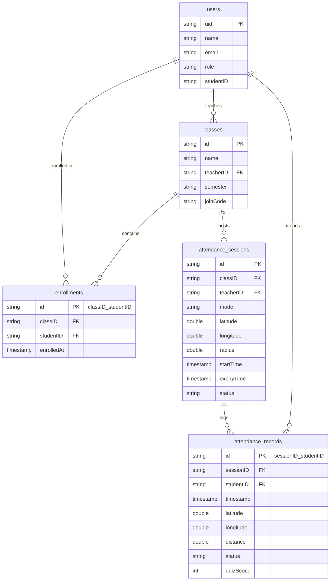

# ClassTrack 🎓📍
### Smart Mobile Attendance and Quiz System

[](https://flutter.dev)
[](https://dart.dev)
[](https://firebase.google.com)
[]()
[]()

---

## 📌 1. Project Overview

**ClassTrack** is a smart mobile application designed to eliminate fraudulent and proxy attendance in university classrooms. Traditional manual attendance or paper sign-in sheets are prone to abuse, where absent students have classmates sign on their behalf. 

ClassTrack solves this by combining **GPS geofencing** and a **strict 2-minute time window**, offering two distinct verification modes managed by the instructor.

* **Course:** Mobile Programming – Level 2
* **Instructor:** Dr. Amany
* **Team Size:** 5 Students
* **Technology Stack:** Flutter (Dart), Firebase (Auth, Cloud Firestore, Storage)

---

## 🎯 2. Core Attendance Modes

### 📍 Mode 1 — Location-Based Punch-In
1. The teacher starts a short attendance session inside the classroom and configures the permitted geographical radius (e.g., 50m).
2. The session stays active for **exactly 2 minutes**.
3. All enrolled students see the active session.
4. When a student presses **PUNCH IN**:
   * The app captures device GPS coordinates.
   * Distance between student and teacher is computed using the **Haversine formula**.
   * If `Distance <= Allowed Radius` $\rightarrow$ Recorded as **`Present`**.
   * If `Distance > Allowed Radius` $\rightarrow$ Attempt is **`Rejected`**.

### 📝 Mode 2 — Location-Restricted Quiz
1. The teacher launches a 2-minute timed quiz session.
2. The quiz consists of **5 Multiple-Choice Questions (MCQ)** built directly inside Flutter.
3. An active **countdown timer** runs from `02:00` to `00:00`.
4. A student must:
   * Be enrolled in the class.
   * Be physically inside the classroom (`Distance <= Radius`).
   * Answer all 5 questions and submit before timer expiration.
5. The system records score (out of 5), location verification, submission timestamp, and attendance status.

---

## 🛡️ 3. Critical System Rules

> [!IMPORTANT]
> **1. Unrestricted Session Visibility:**  
> All enrolled students **MUST** be able to see active sessions, regardless of their current location. Distance is only evaluated upon punch-in or quiz submission to determine acceptance vs rejection.

> [!WARNING]
> **2. Backend Validation (No Client-Only Decisions):**  
> Final attendance decisions must never rely solely on client-side logic. The backend re-verifies session status, 2-minute expiration, student enrollment, radius validation, and duplicate prevention.

> [!NOTE]
> **3. Duplicate Prevention:**  
> Enforced via deterministic compound keys:  
> `attendance_records/{sessionID}_{studentID}` — each student may have at most **ONE** accepted attendance record per session.

---

## 👥 4. Team Work Division (5 Members)

To ensure fair contribution and zero merge conflicts, the project is structured across 5 distinct feature tracks:

| Member | Feature Track | Core Responsibilities | Git Branch |
| :--- | :--- | :--- | :--- |
| **Member 1** | **Authentication & Roles** | Firebase Auth (Login/Register), `UserModel`, role-based routing (Teacher vs. Student). | `feature/auth` |
| **Member 2** | **Teacher & Classes** | Teacher Home, class creation, 6-char Join Code generation, enrolled student lists. | `feature/teacher-classes` |
| **Member 3** | **Student & Mode 1** | Join class by code, `LocationService` (GPS permissions, Haversine formula), Mode 1 Punch-In flow. | `feature/student-punchin` |
| **Member 4** | **Mode 2: Quiz System** | 5 MCQ questions UI, 2-minute in-app countdown timer, score calculation, quiz submission. | `feature/quiz-mode` |
| **Member 5** | **Live Monitor & Rules** | Teacher live attendance stream, session history, Firestore security rules, README & testing. | `feature/dashboard-rules` |

👉 **For the complete task-by-task breakdown, see [TEAM_RESPONSIBILITIES.md](TEAM_RESPONSIBILITIES.md).**

---

## 🏗️ 5. Project Architecture & Directory Structure

```text
class_track/
├── android/                    # Android platform configuration & permissions
├── ios/                        # iOS platform configuration
├── lib/
│   ├── main.dart               # App entry point & Firebase initialization
│   ├── core/                   # Shared constants, colors, and Haversine math
│   │   ├── constants.dart
│   │   ├── distance_calculator.dart
│   │   └── routes.dart
│   ├── models/                 # Data contracts matching Firestore schema
│   │   ├── user_model.dart
│   │   ├── class_model.dart
│   │   ├── enrollment_model.dart
│   │   ├── session_model.dart
│   │   ├── attendance_model.dart
│   │   └── quiz_model.dart
│   ├── services/               # Hardware & Cloud communication
│   │   ├── auth_service.dart
│   │   ├── firestore_service.dart
│   │   └── location_service.dart
│   ├── screens/                # UI presentation layers
│   │   ├── auth/               # Login & Registration screens
│   │   ├── teacher/            # Class creation, live monitor & history
│   │   ├── student/            # Enrolled classes, Punch-in screens
│   │   └── quiz/               # 5-question quiz UI & results
│   └── widgets/                # Reusable UI components
├── TEAM_RESPONSIBILITIES.md    # Complete 5-student work division
├── AGENT_SYSTEM_RULES.md       # AI agent constraints & design directives
├── AUDIT_LOG.md                # System audit trail & progress log
├── firestore.rules             # Backend Firestore security rules
└── pubspec.yaml                # Flutter project dependencies
```

---

## 🗄️ 6. Cloud Firestore Schema



---

## 🚀 7. Getting Started

### Prerequisites
* [Flutter SDK](https://docs.flutter.dev/get-started/install) (v3.41+ recommended)
* [Dart SDK](https://dart.dev/get-dart) (v3.11+)
* A physical device or emulator with GPS location services enabled

### Installation Steps

1. **Clone the repository:**
   ```bash
   git clone https://github.com/7efnawi/class_track.git
   cd class_track
   ```

2. **Install Flutter dependencies:**
   ```bash
   flutter pub get
   ```

3. **Firebase Setup:**
   * Create a project in the [Firebase Console](https://console.firebase.google.com).
   * Enable **Email/Password Authentication** in Firebase Auth.
   * Enable **Cloud Firestore Database** (Test or Production mode).
   * Add Android app and place `google-services.json` inside `android/app/`.

4. **Run the Application:**
   ```bash
   flutter run
   ```

---

## 🌿 8. Git Workflow & Best Practices

1. **`main`**: Production-ready, fully tested code for submission.
2. **`develop`**: Central integration branch for team collaboration.
3. **Feature Branches**:
   ```bash
   git checkout develop
   git pull origin develop
   git checkout -b feature/<feature-name>
   ```
4. **Commit Convention:**
   * `feat: add 5-question quiz UI with radio buttons`
   * `fix: correct Haversine distance unit conversion`
   * `docs: update setup steps in README`

---

## 📅 9. Four-Week Development Milestones

* **Week 1 (Foundation):** Project setup, Firebase connection, Auth, user roles, class creation, and joining via code.
* **Week 2 (Mode 1 - Punch-In):** GPS acquisition, 2-minute session lifecycle, radius validation, punch-in submission.
* **Week 3 (Mode 2 - Quiz):** In-app 5 questions, countdown timer, auto-submit, score calculation, and location-gated results.
* **Week 4 (Monitoring & Polish):** Teacher live monitoring dashboard, past session history, UI polish, demo testing.

---

## 📄 10. Key Documentation Files

* 📋 **[TEAM_RESPONSIBILITIES.md](TEAM_RESPONSIBILITIES.md):** Full individual breakdown for the 5 students.
* 🤖 **[AGENT_SYSTEM_RULES.md](AGENT_SYSTEM_RULES.md):** Architectural boundaries and guidelines for AI coding agents.
* 📝 **[AUDIT_LOG.md](AUDIT_LOG.md):** Detailed development changelog and audit trail.

---

© 2026 ClassTrack Team. Developed for Mobile Programming – Level 2 under the supervision of **Dr. Amany**.
